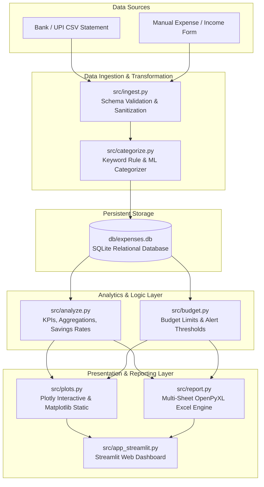
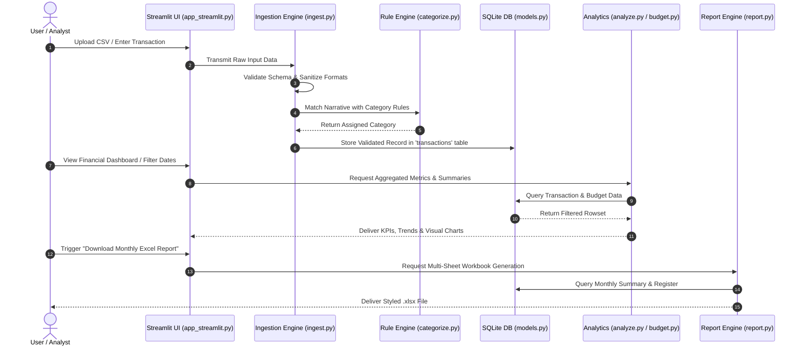

# Personal Expense Tracker with Data Visualization

[](https://www.python.org/)
[](https://streamlit.io/)
[](https://www.sqlite.org/)
[](LICENSE)
[]()

> **Project Status (Production Ready & Fully Tested)**: The application is complete, tested, and operational. It features persistent SQLite data storage, automatic keyword categorization, interactive Plotly visualizations, real-time monthly budget tracking with overspending alerts, and multi-sheet OpenPyXL Excel report exports.

---

## Table of Contents

1. [Project Title](#1-project-title)
2. [Project Overview](#2-project-overview)
3. [Problem Statement](#3-problem-statement)
4. [Project Objectives](#4-project-objectives)
5. [Industry Relevance](#5-industry-relevance)
6. [Key Features](#6-key-features)
7. [Technology Stack](#7-technology-stack)
8. [System Architecture](#8-system-architecture)
9. [Data Flow Explanation](#9-data-flow-explanation)
10. [Database Overview](#10-database-overview)
11. [Folder Structure](#11-folder-structure)
12. [Installation Requirements](#12-installation-requirements)
13. [Windows Installation Instructions](#13-windows-installation-instructions)
14. [macOS Installation Instructions](#14-macos-installation-instructions)
15. [Virtual Environment Setup](#15-virtual-environment-setup)
16. [Required Library Installation](#16-required-library-installation)
17. [How to Run the Application](#17-how-to-run-the-application)
18. [Sample Dataset Explanation](#18-sample-dataset-explanation)
19. [Expected Dashboard Outputs](#19-expected-dashboard-outputs)
20. [Report Generation Details](#20-report-generation-details)
21. [GitHub Setup and Upload Instructions](#21-github-setup-and-upload-instructions)
22. [Screenshots and Visual Layouts](#22-screenshots-and-visual-layouts)
23. [Learning Outcomes](#23-learning-outcomes)
24. [Future Enhancements](#24-future-enhancements)

---

## 1. Project Title

**Personal Expense Tracker with Data Visualization**  
*An industry-grade personal finance management and analytics platform engineered in Python.*

---

## 2. Project Overview

The **Personal Expense Tracker with Data Visualization** is an end-to-end personal finance management platform designed to provide complete control over personal income, expenses, and savings. 

Operating entirely on a local **SQLite** relational database with an interactive **Streamlit** web browser interface, the application eliminates third-party cloud vulnerabilities and credentials risks. It automates bank and UPI statement ingestion via CSV, supports manual cash and card entries, applies intelligent keyword categorization, tracks category-level budget limits with automated overspending alerts, and exports executive multi-sheet **Microsoft Excel (.xlsx)** reports styled with **OpenPyXL**.

All financial figures are standardized in Indian Rupees (**₹ - INR**), adhering to Indian personal finance contexts (e.g., UPI payments, debit/credit cards, Kirana purchases, food delivery apps, and utility bills).

---

## 3. Problem Statement

Modern individuals execute tens to hundreds of digital financial transactions every month across disparate channels:
- Unified Payments Interface (UPI apps: GPay, PhonePe, Paytm)
- Credit and Debit Cards
- Net Banking Transfers
- Physical Cash

Key challenges addressed:
1. **Financial Fragmentation**: Expense records remain scattered across disparate bank portals, payment apps, and paper receipts without a single consolidated view.
2. **Obscure Transaction Narratives**: Raw bank statement descriptions (e.g., `UPI/428391029/SWIGGY`) obscure true spending habits, making manual tracking tedious and error-prone.
3. **Absence of Real-Time Budget Control**: Consumers frequently exceed discretionary budgets because they lack continuous visibility and proactive warning alerts.
4. **Privacy and Security Risks**: Commercial expense tracker applications often require sensitive banking credentials or store private financial records on third-party cloud servers.
5. **Static, Non-Interactive Reporting**: Generic mobile banking apps offer limited data visualization and lack customizable Excel report export capabilities for personal accounting or tax preparation.

---

## 4. Project Objectives

The project delivers:
- **Dual-Channel Ingestion**: Automated CSV statement imports with alias mapping and duplicate prevention, alongside form-based manual transaction entry.
- **Automated Rule-Based Categorization**: An intelligent keyword classification engine that categorizes transactions into standard personal finance sectors (Food & Dining, Groceries, Transport, Bills & Utilities, Shopping, Entertainment, Healthcare, Education, Rent, Travel, Income, Uncategorized).
- **Persistent Local Data Storage**: A normalized SQLite database with foreign key relationships (`PRAGMA foreign_keys = ON;`), indexes, and transactional ACID guarantees.
- **Interactive Visual Dashboard**: A modern, responsive Streamlit dashboard featuring Key Performance Indicators (KPIs), interactive Plotly donut charts, income vs. expense bar charts, daily spending curves, and moving averages.
- **Proactive Budget Monitoring**: Category-level monthly spending limits with multi-stage threshold warnings (`Within Budget`, `Approaching Budget` at 80%, `Budget Exceeded` at 100%).
- **Corporate-Grade Excel Exporting**: Automated generation of professionally formatted, 4-sheet Excel reports styled with OpenPyXL.

---

## 5. Industry Relevance

This project reflects standard Fintech and Data Engineering industry practices:
- **ETL Data Pipelines**: Extracting unorganized raw transaction logs from CSVs, Transforming them via cleaning, normalization, and categorization rules, and Loading them into structured relational tables (ETL).
- **Relational Data Modeling**: Real-world application of database normalization, schema design, foreign key constraints, and index optimization in SQLite.
- **Data Analytics & Business Intelligence (BI)**: Generating aggregate financial metrics, month-over-month trajectories, savings ratios, and distribution percentages using **Pandas** and **NumPy**.
- **Interactive Dashboard Engineering**: Designing intuitive UI/UX with state management, interactive data filtering, and high-framerate rendering via **Streamlit** and **Plotly**.
- **Automated Enterprise Reporting**: Utilizing **OpenPyXL** to produce formatted, multi-tab executive spreadsheets mimicking enterprise financial reporting standards.

---

## 6. Key Features

All core features are implemented and tested:

| Feature Category | Implementation Details | Status |
| :--- | :--- | :--- |
| **Data Ingestion** | CSV statement parser with alias mapping, duplicate detection, and validation checks (`src/ingest.py`) | **Complete & Verified** |
| **Manual Entry** | Web form capturing date, description, amount, account, category, and tags with automatic sign enforcement | **Complete & Verified** |
| **Categorization** | Keyword rule engine covering Indian merchants (Swiggy, DMart, Uber, BESCOM, etc.) + Uncategorized fallback (`src/categorize.py`) | **Complete & Verified** |
| **Transaction Management** | Full CRUD capabilities: search, filter by date/account/category, inline editing, and deletion with confirmation (`src/ingest.py`) | **Complete & Verified** |
| **Analytics Engine**| Dynamic calculations for Total Income, Expenses, Savings, Savings Rate, Top Category, and Daily Velocity (`src/analyze.py`) | **Complete & Verified** |
| **Budget Management**| Monthly budget limits by category, variance calculation, remaining amounts, and overspending alert banners (`src/budget.py`) | **Complete & Verified** |
| **Visualizations** | All 4 required charts (Category bar, Monthly trend line, Payment method pie, Daily trend line) + auxiliary charts (`src/plots.py`) | **Complete & Verified** |
| **Excel Reporting** | Multi-sheet OpenPyXL report generator with corporate styling and INR currency formatting (`src/report.py`) | **Complete & Verified** |
| **Streamlit Dashboard** | 7-tab modern web dashboard with sidebar navigation, month filters, and instant reactive updates (`src/app_streamlit.py`) | **Complete & Verified** |
| **CLI Orchestrator** | Unified entry point (`main.py`) supporting `--dashboard`, `--init-db`, `--import-csv`, `--summary`, and `--report` | **Complete & Verified** |

---

## 7. Technology Stack

- **Core Language**: Python 3.11 / Python 3.12
- **Data Processing & Analytics**: Pandas (`>=2.1.0`), NumPy (`>=1.26.0`)
- **Database Engine**: SQLite (Python standard library `sqlite3`, zero external server dependency)
- **Interactive Web Interface**: Streamlit (`>=1.35.0`)
- **Data Visualization**: Plotly (`>=5.22.0`), Matplotlib (`>=3.8.0`)
- **Report Generation**: OpenPyXL (`>=3.1.2`)
- **Machine Learning (Optional)**: Scikit-learn (`>=1.4.0`)
- **Version Control & Collaboration**: Git & GitHub

---

## 8. System Architecture



---

## 9. Data Flow Explanation



---

## 10. Database Overview

The storage layer is backed by a local **SQLite** database (`db/expenses.db`) with foreign key constraints enabled (`PRAGMA foreign_keys = ON;`).

### 1. `categories` Table
```sql
CREATE TABLE IF NOT EXISTS categories (
    id INTEGER PRIMARY KEY AUTOINCREMENT,
    name TEXT NOT NULL UNIQUE,
    parent TEXT DEFAULT NULL
);
```

### 2. `transactions` Table
```sql
CREATE TABLE IF NOT EXISTS transactions (
    id INTEGER PRIMARY KEY AUTOINCREMENT,
    tx_date TEXT NOT NULL,
    description TEXT NOT NULL,
    amount REAL NOT NULL,
    currency TEXT DEFAULT 'INR',
    account TEXT NOT NULL,
    category_id INTEGER,
    raw_source TEXT DEFAULT 'MANUAL',
    tags TEXT DEFAULT '',
    FOREIGN KEY (category_id) REFERENCES categories(id) ON DELETE SET NULL
);
```

### 3. `budgets` Table
```sql
CREATE TABLE IF NOT EXISTS budgets (
    id INTEGER PRIMARY KEY AUTOINCREMENT,
    month TEXT NOT NULL,
    category_name TEXT NOT NULL,
    limit_amount REAL NOT NULL,
    UNIQUE(month, category_name)
);
```

---

## 11. Folder Structure

```
Personal-Expense-Tracker/
│
├── data/
│   └── sample_expenses.csv       # High-quality synthetic Indian personal finance dataset
│
├── db/
│   ├── .gitkeep                  # Preserves SQLite database directory in version control
│   └── expenses.db               # Local SQLite database (auto-generated)
│
├── src/
│   ├── __init__.py               # Package marker and version declarations
│   ├── models.py                 # SQLite schema (DDL), connection factory & DTOs
│   ├── ingest.py                 # CSV ingestion, data validation & manual entry logic
│   ├── categorize.py             # Keyword rule-based & ML categorization engine
│   ├── analyze.py                # Financial KPI computation & aggregation logic
│   ├── budget.py                 # Budget tracking, variance & threshold alerting
│   ├── plots.py                  # Plotly interactive & Matplotlib static visualizations
│   ├── report.py                 # Multi-sheet OpenPyXL Excel export engine
│   └── app_streamlit.py          # Interactive Streamlit web application dashboard
│
├── outputs/
│   ├── .gitkeep                  # Preserves report outputs directory in version control
│   └── Financial_Report_*.xlsx   # Generated Excel workbooks
│
├── README.md                     # Comprehensive project documentation
├── requirements.txt              # Pinned, compatible Python library dependencies
├── .gitignore                    # Git rules ignoring cache, venvs, DBs, and outputs
└── main.py                       # CLI application launcher and orchestration entry point
```

---

## 12. Installation Requirements

- **Operating System**: Windows 10/11, macOS (Monterey 12+), or Linux (Ubuntu 20.04+)
- **Python**: Version `3.11` or `3.12`
- **Package Manager**: `pip`
- **Memory**: 4 GB RAM minimum (8 GB recommended for interactive Plotly visuals)
- **Disk Space**: ~500 MB for virtual environment and libraries

---

## 13. Windows Installation Instructions

```powershell
# 1. Open PowerShell and navigate to your project directory
cd "c:\Users\Sufff_x25\Desktop\Personal Expense Tracker with Data Visualization"

# 2. Check Python installation
python --version

# 3. Create a dedicated virtual environment
python -m venv venv

# 4. Activate the virtual environment
.\venv\Scripts\Activate.ps1
# (If script execution policy restricts activation: Set-ExecutionPolicy -Scope Process -ExecutionPolicy Bypass)

# 5. Upgrade pip
python -m pip install --upgrade pip

# 6. Install required packages
pip install -r requirements.txt
```

---

## 14. macOS Installation Instructions

```bash
# 1. Open Terminal and navigate to the project directory
cd ~/Desktop/"Personal Expense Tracker with Data Visualization"

# 2. Check Python installation
python3 --version

# 3. Create a virtual environment
python3 -m venv venv

# 4. Activate the virtual environment
source venv/bin/activate

# 5. Upgrade pip and install dependencies
python -m pip install --upgrade pip
pip install -r requirements.txt
```

---

## 15. Virtual Environment Setup

Using an isolated virtual environment guarantees that project dependencies do not conflict with system-wide Python libraries.

### Verification of Active Virtual Environment:
- **Windows**: The terminal prompt will display `(venv)` prefix:
  ```text
  (venv) PS C:\Users\Sufff_x25\Desktop\Personal Expense Tracker with Data Visualization>
  ```
- **macOS / Linux**: The terminal prompt will display:
  ```text
  (venv) user@macbook:~/Personal Expense Tracker with Data Visualization$
  ```

### Deactivating the Environment:
```bash
deactivate
```

---

## 16. Required Library Installation

The `requirements.txt` file specifies only essential, mutually compatible libraries:

```text
pandas>=2.1.0,<3.0.0
numpy>=1.26.0,<2.0.0
streamlit>=1.35.0,<2.0.0
matplotlib>=3.8.0,<4.0.0
plotly>=5.22.0,<8.0.0
openpyxl>=3.1.2,<4.0.0
scikit-learn>=1.4.0,<2.0.0
```

> **Note on SQLite**: SQLite is natively built into Python's standard library (`sqlite3`). It requires no external package installation via pip.

---

## 17. How to Run the Application

### 1. Primary Method — Launch the Streamlit Web Dashboard:
```bash
streamlit run src/app_streamlit.py
```
*The web browser will automatically open at `http://localhost:8501`.*

### 2. Secondary Method — Launch via CLI Entry Point (`main.py`):
```bash
# Default launcher (starts dashboard)
python main.py

# Initialize database schema and seed sample data
python main.py --init-db

# View console financial KPI summary
python main.py --summary

# Ingest an external CSV file
python main.py --import-csv data/sample_expenses.csv

# Generate monthly Excel report
python main.py --report 2024-10
```

---

## 18. Sample Dataset Explanation

The dataset at `data/sample_expenses.csv` includes **116 synthetic records** reflecting realistic Indian personal finance patterns:

- **Columns**: `tx_date`, `description`, `amount`, `account`, `raw_source`
- **Monetary Rules**:
  - **Negative Values**: Expenses (e.g., `-22000.00` for house rent, `-845.50` for Blinkit, `-1850.00` for BESCOM electricity).
  - **Positive Values**: Income / Credits (e.g., `85000.00` for monthly tech salary, `25000.00` for bonus, `15000.00` for consulting, `899.00` for Amazon refund).
- **Time Span**: August 2024 through November 2024 (4 consecutive months).
- **Payment Accounts**: `UPI`, `Debit Card`, `Credit Card`, `Cash`.
- **Automatic Seed**: On the first launch, if the database is empty, the application automatically loads these records and initializes sample budgets.

---

## 19. Expected Dashboard Outputs

The Streamlit dashboard features 7 dedicated sections:

1. **📊 Overview**:
   - 5 KPI Scorecards: Total Income, Total Expenses, Net Savings, Savings Rate (%), Top Spending Category.
   - Category spending donut chart & Monthly Income vs. Expenses grouped bar chart.
   - Recent transaction register preview.
2. **➕ Add Transaction**:
   - Form with Date, Description, Amount, Type (Expense/Income), Payment Method, Category dropdown, and Notes.
   - Enforces sign convention: Expenses are automatically saved as negative numbers; Income as positive.
3. **📥 Import CSV**:
   - Drag-and-drop CSV uploader with column alias auto-detection.
   - Ingestion summary with duplicate count and validation notices.
4. **📋 Transaction History**:
   - Filterable by Date, Category, Payment Account, and Transaction Type.
   - Search box for narrative text or tags.
   - Inline transaction editor and permanent delete tool with confirmation protection.
5. **📈 Analytics & Charts**:
   - Required Chart 1: Category-wise spending bar chart.
   - Required Chart 2: Monthly spending trend line chart.
   - Required Chart 3: Payment-method distribution donut/pie chart.
   - Required Chart 4: Daily spending trend with 7-day rolling average.
6. **🎯 Budget Management**:
   - Monthly category budget setter with remaining balance calculations.
   - Real-time overspending alerts (`SAFE`, `WARNING`, `EXCEEDED`).
   - Budget limit vs. actual spending horizontal comparison chart.
7. **📄 Reports & Export**:
   - Month selection dropdown.
   - Direct download button for OpenPyXL multi-sheet Excel reports.
   - CSV export of full transaction database.

---

## 20. Report Generation Details

The report generation module (`src/report.py`) utilizes **OpenPyXL** to build corporate-styled workbooks:

### Report Workbook Structure:
- **Sheet 1: Transactions**: Itemized transaction log (Date, Description, Amount, Account, Category, Currency).
- **Sheet 2: Category Summary**: Category spending totals and percentage share of total outflow.
- **Sheet 3: Monthly Summary**: Month-over-month trajectory (Income, Expenses, Savings, Savings Rate).
- **Sheet 4: Budget Summary**: Budget caps, actual expenses, remaining balances, and alert status flags.

### Formatting & Visual Standards:
- Corporate Dark Navy headers (`#1F497D`) with bold white text.
- Formatted Indian Rupee currency cells: `₹#,##0.00`.
- Auto-adjusted column widths and thin border grids.

---

## 21. GitHub Setup and Upload Instructions

```bash
# 1. Initialize git repository
git init

# 2. Stage all files (verifying .gitignore excludes db/*.db, outputs/*.xlsx, venv/)
git add .

# 3. Commit the completed application
git commit -m "feat: complete personal expense tracker with data visualization (PART 2)"

# 4. Set main branch
git branch -M main

# 5. Link your GitHub remote repository
git remote add origin https://github.com/your-username/Personal-Expense-Tracker.git

# 6. Push to GitHub
git push -u origin main
```

---

## 22. Screenshots and Visual Layouts

```
===================================================================================
                   PERSONAL EXPENSE TRACKER - DASHBOARD OVERVIEW
===================================================================================

 [ KPI: Total Income ]    [ KPI: Total Expenses ]    [ KPI: Net Savings ]    [ KPI: Rate ]
      ₹396,648.00               ₹237,906.50              ₹158,741.50            40.02%
 ---------------------------------------------------------------------------------
 [ Plotly Donut: Category Outflows ]      [ Plotly Bar: Monthly Inflow vs Outflow ]
  - Rent: 37.0%                            - Aug: In ₹100k | Out ₹58k
  - Groceries: 15.2%                       - Sep: In ₹110k | Out ₹59k
  - Food & Dining: 8.8%                    - Oct: In ₹123k | Out ₹69k
  - Shopping: 12.4%                        - Nov: In ₹85k  | Out ₹51k
===================================================================================
```

*Actual Console Output (`python main.py --summary`):*
```text
==================================================
 FINANCIAL SUMMARY OVERVIEW
==================================================
 Total Inflow (Income)   : ₹396,648.00
 Total Outflow (Expenses): ₹237,906.50
 Net Savings Balance     : ₹158,741.50
 Savings Ratio           : 40.02%
 Top Outflow Category    : Rent (₹88,000.00)
 Average Daily Spend     : ₹2,379.07
 Total Transactions Logged: 116
==================================================
```

---

## 23. Learning Outcomes

- **Architectural Separation of Concerns**: Decoupled database schema (`models.py`), ETL ingestion (`ingest.py`), rule engine (`categorize.py`), financial mathematics (`analyze.py`), visualization (`plots.py`), spreadsheet generation (`report.py`), and reactive UI (`app_streamlit.py`).
- **Defensive Data Engineering**: Input sanitation, date normalization, duplicate detection, sign enforcement for cash flows, and graceful empty data handling.
- **Relational Integrity**: Enforcing foreign key constraints in SQLite, index optimization, and conflict resolution upserts for budgets.
- **Business Intelligence Reporting**: Programmatic Excel spreadsheet authoring with OpenPyXL, custom formatting strings, and auto-adjusted layout dimensions.

---

## 24. Future Enhancements

1. **Machine Learning Categorization**: Train Scikit-learn TF-IDF + Multinomial Naive Bayes models on historical user edits for adaptive self-learning categorization.
2. **OCR Receipt Scanner**: Integrate Tesseract OCR or vision models to scan paper receipts and supermarket bills directly into transaction entries.
3. **Automated SMS & Email Parser**: Offline Android SMS parsing utility to automatically capture bank debit/credit alert messages.
4. **Multi-Currency Support**: Support dynamic foreign currency conversions (USD, EUR, GBP to INR) for international travels and freelance earnings.
5. **Encrypted SQLite Database**: Integrate SQLCipher to encrypt the local database file at rest with user master password protection.

---

## Final Project Status

- [x] **PART 1: Project Initialization, Documentation & File Structure** (Completed)
- [x] **PART 2: Complete Development, Implementation, Testing & Final Delivery** (Completed & Verified)
